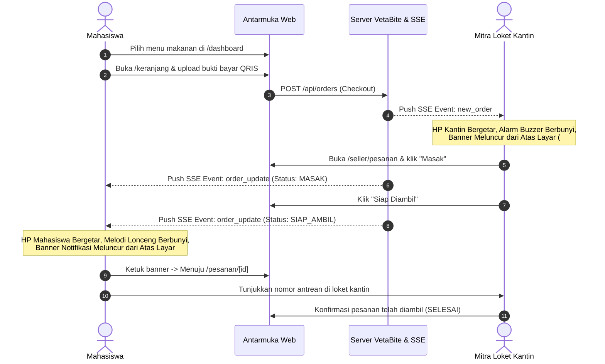

# Panduan Lengkap Pengujian Fitur & Workflow Sistem VetaBite

> **Dokumen Pengujian Pengguna (User Acceptance Testing / UAT Guide)**  
> Platform Pemesanan dan Antrean Cerdas Kantin UPN "Veteran" Jakarta  
> Target Pengguna: Penguji Sistem, Tim Pengembang, Administrator, Mitra Kantin, dan Mahasiswa.

---

## 1. Daftar Kredensial Akun Pengujian (Testing Accounts)

Gunakan akun-akun berikut untuk menguji seluruh hak akses (Role-Based Access Control / RBAC) di sistem VetaBite:

| Peran (Role) | Username / Email | Password | Halaman Akses Utama |
| :--- | :--- | :--- | :--- |
| **Administrator Utama** | `dhafagifari0412@gmail.com` | `Admin123!` | `/admin/verifikasi` & `/seo` |
| **Mitra Kantin Demo C** | `demo-C@kantin.local` | `Kantin123!` | `/seller/pesanan` |
| **Mitra Kantin Demo A** | `demo-A@kantin.local` | `Kantin123!` | `/seller/pesanan` |
| **Mahasiswa (SSO)** | Akun Google UPNVJ (`*@mahasiswa.upnvj.ac.id`) | SSO Google | `/dashboard` |
| **Mahasiswa (Manual)** | Akun baru via `/register` | Sesuai pendaftaran | `/dashboard` |

---

## 2. Diagram Alur Transaksi & Real-time Notification

---

## 3. Skenario Pengujian Modul per Modul

---

### MODUL 1: Autentikasi, Login, Google SSO & Reset Password

#### Skenario 1.1: Login Mahasiswa via Google SSO
1. Buka halaman `https://vetabite.my.id/login`.
2. Klik tombol **"Masuk dengan Akun Mahasiswa Google SSO"**.
3. Pilih akun email civitas akademika UPNVJ (`@mahasiswa.upnvj.ac.id`).
4. **Hasil yang Diharapkan:** Pengguna otomatis diarahkan ke `/dashboard`, nama mahasiswa dan NIM terbaca dari profil Google, serta status akun aktif.

#### Skenario 1.2: Login Mitra Loket Kantin
1. Buka halaman `https://vetabite.my.id/login`.
2. Klik tab **"Mitra Kantin"**.
3. Masukkan username `demo-C@kantin.local` dan password `Kantin123!`.
4. Klik **"Masuk ke Panel Penjual"**.
5. **Hasil yang Diharapkan:** Pengguna langsung diarahkan ke halaman antrean dapur kantin (`/seller/pesanan`).

#### Skenario 1.3: Login Administrator Khusus
1. Buka halaman `https://vetabite.my.id/admin/login`.
2. Masukkan email `dhafagifari0412@gmail.com` dan password `Admin123!`.
3. Klik **"Masuk Administrator"** (atau gunakan tombol Google SSO Admin).
4. **Hasil yang Diharapkan:** Pengguna masuk ke panel verifikasi kantin (`/admin/verifikasi`). Jika akun bukan admin, akses wajib ditolak.

#### Skenario 1.4: Lupa & Reset Password
1. Buka `https://vetabite.my.id/login`, klik tautan **"Lupa Password?"** menuju `/reset-password`.
2. Masukkan username atau email akun yang terdaftar.
3. Masukkan password baru dan konfirmasi password baru (minimal 8 karakter).
4. Klik tombol **"Simpan Password Baru"**.
5. **Hasil yang Diharapkan:** Sistem memvalidasi identitas, meng-hash password baru dengan aman, dan menampilkan notifikasi sukses. Pengguna dapat langsung login kembali menggunakan password baru.

---

### MODUL 2: Pemesanan Mahasiswa (Order Workflow)

#### Skenario 2.1: Pencarian & Pemilihan Menu
1. Buka halaman `/dashboard`.
2. Jelajahi loket kantin yang sedang buka atau ketik nama menu di bar pencarian `/search` (misal: "Ayam Geprek" atau "Es Teh").
3. Pilih loket kantin yang diinginkan (misal: "Kantin Demo C").
4. Pilih menu makanan, atur jumlah porsi, dan tambahkan catatan khusus jika diperlukan (misal: "Sambal dipisah").
5. Klik **"Tambah ke Keranjang"**.
6. **Hasil yang Diharapkan:** Badge jumlah barang pada ikon keranjang di dock bawah bertambah secara real-time.

#### Skenario 2.2: Checkout & Unggah Bukti Pembayaran QRIS
1. Buka halaman `/keranjang`.
2. Periksa rincian pesanan dan total harga dalam format Rupiah (misal: `Rp 18.000`).
3. Pilih metode pembayaran **QRIS**. Pindai barcode QRIS resmi yang ditampilkan pada layar.
4. Unggah file tangkapan layar bukti transfer (format file didukung: JPEG, PNG, WebP; batas ukuran maksimal 5 MB).
5. Klik tombol **"Pesan Sekarang"**.
6. **Hasil yang Diharapkan:** Server memvalidasi keabsahan bukti bayar. Pesanan berhasil dibuat dengan **Nomor Antrean Harian** unik (misal: `#C-001`). Layar otomatis berpindah ke halaman pelacakan pesanan `/pesanan/[id]`.

#### Skenario 2.3: Pelacakan Status Real-Time (Server-Sent Events)
1. Perhatikan indikator langkah status di `/pesanan/[id]`:
   - `ANTRIAN`: Pesanan menunggu konfirmasi dapur kantin.
   - `MASAK`: Dapur kantin sedang menyiapkan hidangan.
   - `SIAP_AMBIL`: Makanan telah selesai dimasak dan siap diambil di loket.
   - `SELESAI`: Pesanan telah diambil oleh mahasiswa.
2. **Hasil yang Diharapkan:** Setiap kali status diubah oleh penjual, halaman mahasiswa otomatis terbarui dalam hitungan detik **tanpa perlu me-refresh halaman browser**.

---

### MODUL 3: Pengelolaan Dapur & Loket Penjual (Seller Workflow)

#### Skenario 3.1: Menerima Pesanan Baru
1. Penjual membuka halaman `/seller/pesanan` pada ponsel atau laptop dapur.
2. Pastikan banner suara diaktifkan dengan mengklik **"Aktifkan & Tes"**.
3. Saat pesanan mahasiswa masuk dari Modul 2:
4. **Hasil yang Diharapkan:** 
   - Alarm dapur berbunyi nyaring.
   - Perangkat ponsel penjual bergetar (haptic feedback).
   - **Banner Notifikasi HP** meluncur dari bagian atas layar dengan aksen warna oranye, menampilkan nomor antrean, nama pemesan, dan NIM mahasiswa.
   - Kartu pesanan baru otomatis muncul di tab **"Antrean Baru"**.

#### Skenario 3.2: Memeriksa Bukti Bayar & Memproses Pesanan
1. Klik tombol **"Cek Bukti Bayar"** pada kartu pesanan.
2. Periksa gambar transfer yang diunggah mahasiswa.
3. Klik tombol **"Mulai Masak"**.
4. **Hasil yang Diharapkan:** Status pesanan berpindah ke tab **"Sedang Dimasak"**, dan sistem mengirimkan update real-time ke layar mahasiswa.

#### Skenario 3.3: Menyelesaikan Masakan (Siap Diambil)
1. Setelah makanan selesai dikemas, klik tombol **"Siap Diambil"**.
2. **Hasil yang Diharapkan:** Pesanan berpindah ke tab **"Siap Diambil"**. Di perangkat mahasiswa, banner notifikasi penjemputan pesanan otomatis muncul seketika.

#### Skenario 3.4: Buka-Tutup Toko & Kelola Stok Menu
1. Masuk ke menu **Status Toko** (`/seller/status-toko`).
2. Gunakan toggle **Buka / Tutup Loket** untuk mengubah status operasional kantin.
3. Pada daftar menu makanan, tekan tombol switch stok untuk mengubah status menu menjadi **Habis** atau **Tersedia**.
4. **Hasil yang Diharapkan:** Pembeli di `/dashboard` tidak dapat memasukkan menu yang berstatus "Habis" ke dalam keranjang belanja.

#### Skenario 3.5: Manajemen Blacklist / Ban Mahasiswa Nakal
1. Masuk ke menu **Pengaturan Loket** (`/seller/banned`).
2. Masukkan NIM mahasiswa yang sering mengirim bukti bayar palsu atau tidak mengambil pesanan (misal: `2610511099`).
3. Tuliskan alasan pemblokiran, lalu klik **"Blokir Mahasiswa"**.
4. **Hasil yang Diharapkan:** Mahasiswa dengan NIM tersebut otomatis ditolak oleh server saat mencoba melakukan checkout di loket Anda.

---

### MODUL 4: Sistem Notifikasi Banner HP (Mobile Push Banner)

#### Skenario 4.1: Banner Notifikasi HP untuk Mahasiswa (Pesanan Siap)
1. Buka menu **Profil** (`/profil`).
2. Scroll ke bagian **Notifikasi & Suara**.
3. Klik tombol **"Tes Banner Notifikasi HP Sekarang"**.
4. **Hasil yang Diharapkan:**
   - Muncul kartu banner Liquid Glass meluncur turun dari bagian atas layar (`top-2`).
   - Terdapat logo resmi VetaBite, teks `VETABITE • PESANAN SIAP`, dan waktu `Baru saja`.
   - Menampilkan nomor antrean besar hijau emerald (misal `#A-001`) dan nama loket.
   - Melodi lonceng ganda (*dual-tone chime melody*) berbunyi merdu.
   - Ponsel bergetar (*haptic vibration*).
   - Mengetuk banner akan membawa pengguna ke rincian pesanan.
   - Banner menghilang otomatis setelah 10 detik jika tidak diketuk.

#### Skenario 4.2: Banner Notifikasi HP untuk Mitra Kantin (Pesanan Baru)
1. Buka menu **Pesanan Penjual** (`/seller/pesanan`).
2. Klik tombol pengujian pada banner peringatan suara audio.
3. **Hasil yang Diharapkan:**
   - Kartu banner meluncur dari bagian atas layar dengan aksen warna oranye.
   - Header bertuliskan `VETABITE KANTIN • PESANAN BARU`.
   - Menampilkan nomor antrean, nama pemesan, NIM, jumlah menu, dan total rupiah.
   - Alarm buzzer dapur berbunyi terus-menerus.
   - Terdapat tombol cepat **"Diam"** untuk mematikan alarm serta tombol silang untuk menutup notifikasi.

---

### MODUL 5: Panel Khusus Administrator (`/admin/*`)

#### Skenario 5.1: Verifikasi Mitra Kantin Baru
1. Login sebagai Admin di `/admin/login`.
2. Buka halaman `/admin/verifikasi`.
3. Periksa daftar permohonan pendaftaran mitra loket kantin baru (data nama pemilik, nama loket, nomor WhatsApp, foto identitas).
4. Klik **"Setujui (Approve)"** untuk mengaktifkan loket, atau **"Tolak (Reject)"** dengan menyertakan alasan penolakan.
5. **Hasil yang Diharapkan:** Loket yang disetujui langsung memiliki hak login sebagai penjual dan dapat mulai berjualan.

#### Skenario 5.2: Monitoring & Layanan Aduan Mahasiswa (Komplain)
1. Buka halaman `/admin/komplain`.
2. Lihat seluruh keluhan atau laporan masalah yang dikirimkan mahasiswa melalui widget Customer Service.
3. Klik salah satu tiket laporan untuk membaca kronologi dan nomor pesanan yang dipermasalahkan.
4. Masukkan pesan tanggapan admin lalu klik kirim.
5. **Hasil yang Diharapkan:** Status komplain terbarui menjadi `DITANGGAPI` atau `SELESAI`.

#### Skenario 5.3: Statistik & Analitik Kampus
1. Buka halaman `/admin/stats`.
2. Periksa grafik omzet transaksi harian, total pesanan selesai, dan loket kantin paling favorit di lingkungan UPN Veteran Jakarta.

---

### MODUL 6: Panel Pengaturan SEO & Favicon Mandiri (`/seo`)

#### Skenario 6.1: Autentikasi Khusus Panel SEO
1. Akses URL: `https://vetabite.my.id/seo`.
2. Jika belum login sebagai admin, sistem menampilkan antarmuka login khusus administrator tanpa dialihkan ke dashboard lain.
3. Masukkan akun admin (`dhafagifari0412@gmail.com`).
4. **Hasil yang Diharapkan:** Masuk ke dasbor pengelolaan SEO mandiri.

#### Skenario 6.2: Mengubah Favicon & Meta Thumbnail (OG Image)
1. Pada kartu **1. Favicon & Ikon Tab Browser**, klik tombol **"Unggah"** dan pilih file icon/logo.
2. Pada kartu **2. Meta Thumbnail & Share Preview**, klik **"Unggah Gambar"** dan pilih gambar banner promosi.
3. Perhatikan pratinjau langsung di kolom sebelah kanan (Pratinjau Tab Chrome, Pratinjau Hasil Google, dan Pratinjau WhatsApp Share Card).
4. **Hasil yang Diharapkan:** Gambar otomatis dikompresi di browser, disimpan secara persisten ke database Supabase, dan menghasilkan URL bersih `/api/uploads/seo?asset=...`.

#### Skenario 6.3: Integrasi Google Search Console & Simpan Konfigurasi
1. Pada kartu **3. Metadata Search Engine**, periksa atau perbarui Judul Website, Meta Description, Keywords, URL Kanonikal, dan Twitter Handle.
2. Masukkan kode verifikasi HTML dari Google Search Console pada kolom **"Kode Verifikasi Google Search Console"**.
3. Klik tombol **"Simpan Pengaturan SEO"**.
4. **Hasil yang Diharapkan:** Muncul banner notifikasi hijau bertuliskan *"Pengaturan SEO dan Favicon berhasil disimpan"*. Konfigurasi langsung diterapkan secara dinamis ke seluruh halaman web melalui `generateMetadata()`.

---

### MODUL 7: Layanan Bantuan & Customer Service Mahasiswa

#### Skenario 7.1: Menggunakan Floating CS Chat Bubble
1. Buka halaman mahasiswa mana pun (misal `/dashboard` atau `/profil`).
2. Perhatikan tombol lingkaran oranye dengan ikon headphone di sudut kanan bawah area mobile.
3. Klik tombol tersebut untuk membuka modal **Pusat Bantuan & Komplain**.
4. Pilih kategori masalah (misal: "Pesanan Bermasalah", "Pembayaran QRIS", "Kritik & Saran").
5. Tuliskan rincian keluhan lalu klik **"Kirim Laporan"**.
6. **Hasil yang Diharapkan:** Laporan berhasil terkirim dan tercatat di database aduan admin (`/admin/komplain`). Tersedia juga tombol kontak langsung ke WhatsApp resmi Biro Kemahasiswaan UPNVJ.

---

## 4. Matriks Ringkasan Rute & Hak Akses (Route Guard)

| Rute URL | Deskripsi Fungsi | Role yang Diizinkan |
| :--- | :--- | :--- |
| `/dashboard` | Beranda mahasiswa, katalog loket & banner promo | Mahasiswa, Tamu (Guest) |
| `/search` | Pencarian instan menu makanan & loket kantin | Mahasiswa, Tamu |
| `/kantin/[id]` | Menu makanan lengkap dari salah satu loket kantin | Mahasiswa, Tamu |
| `/keranjang` | Keranjang belanja, upload bukti transfer QRIS | Mahasiswa |
| `/pesanan/[id]` | Pelacakan status antrean pesanan real-time | Mahasiswa pemesan |
| `/riwayat` | Daftar riwayat transaksi dan status pembayaran lama | Mahasiswa |
| `/profil` | Pengaturan profil civitas, bahasa, suara & tes notifikasi | Mahasiswa |
| `/seller/pesanan` | Layar antrean dapur, alarm buzzer & status masak | Mitra Penjual |
| `/seller/status-toko`| Manajemen buka/tutup loket & ketersediaan menu | Mitra Penjual |
| `/seller/banned` | Daftar blacklist mahasiswa & profil loket | Mitra Penjual |
| `/seller/statistika`| Laporan penjualan harian/mingguan loket | Mitra Penjual |
| `/admin/verifikasi` | Persetujuan loket kantin baru | Administrator |
| `/admin/komplain` | Penanganan tiket laporan kendala mahasiswa | Administrator |
| `/admin/admins` | Pengelolaan staf admin & loket aktif | Administrator |
| `/admin/stats` | Statistik omzet & transaksi kantin kampus | Administrator |
| `/seo` | Panel pengaturan dinamis SEO, Favicon & Meta Thumbnail | Administrator |
